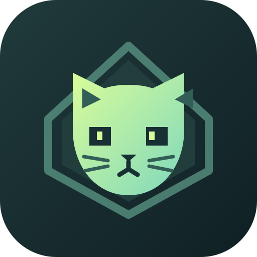
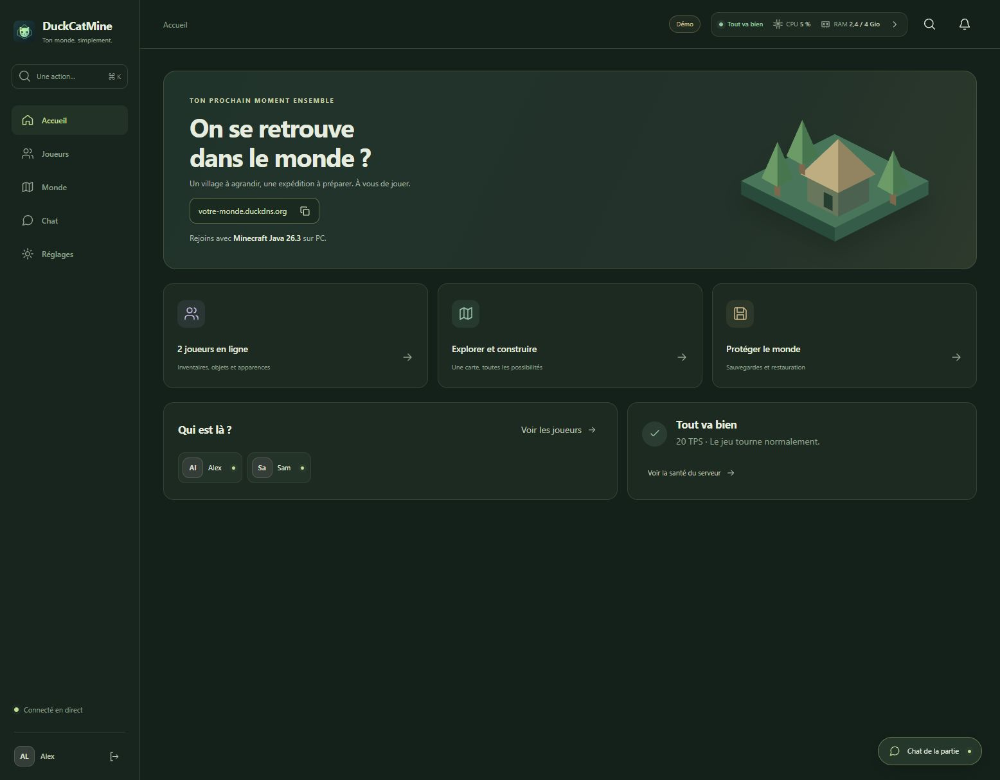
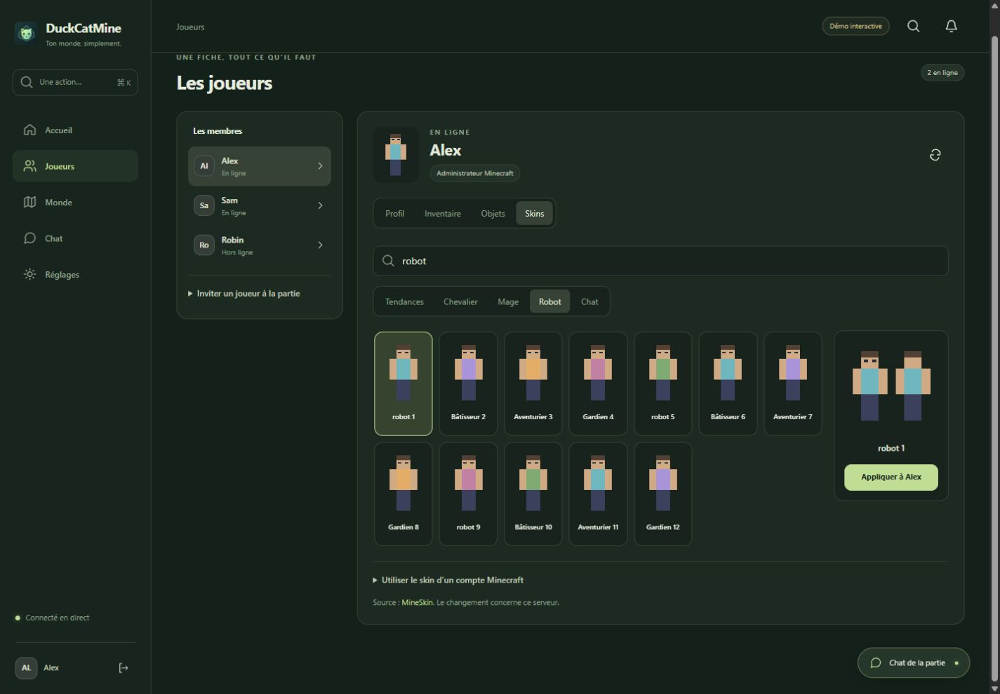
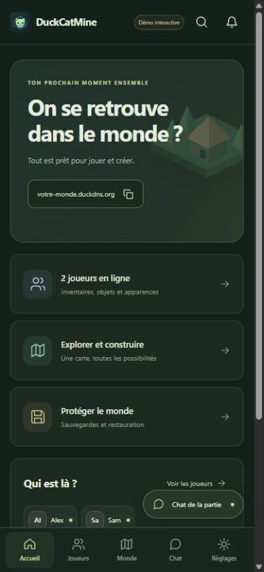
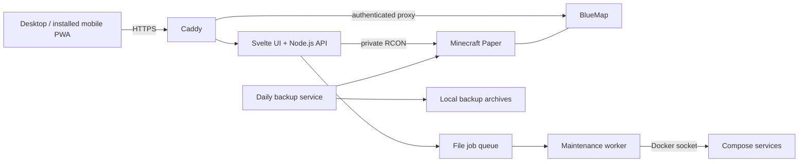

<p align="center"></p>
<h1 align="center">DuckCatMine</h1>
<p align="center"><strong>Your Minecraft server, simply.</strong><br>Free, open source, self-hosted. A visual control panel for your world and your friends.</p>
<p align="center"><a href="https://drslid.github.io/DuckCatMine/">Website</a> · <a href="https://drslid.github.io/DuckCatMine/demo/">Interactive demo</a> · <a href="https://drslid.github.io/DuckCatMine/guides/installation/">Installation guide</a> · <a href="https://github.com/drslid/DuckCatMine/issues">Issues</a></p>



> **Alpha — v0.2.0-alpha.4.** Built for a private Minecraft Java server and a small trusted group. Back up before migrating an existing world. The installer creates a fresh stack and refuses to overwrite an existing installation. Automated upgrades and fine-grained web roles are not included yet.

## Quick install

Requirements:

- A fresh Ubuntu LTS or Debian VPS, x86-64, sudo access.
- 4 GB RAM minimum; 8 GB recommended for ten slots. At least 15 GB free disk, more for worlds and backups.
- `curl`, `tar`, `python3`, CA certificates. Docker Compose; the installer offers the official Docker installation if missing.
- A DuckDNS subdomain or your own domain pointing to the VPS.
- TCP ports 80, 443 and 25565 available and allowed in the provider firewall.
- Official Minecraft Java accounts. You must read and accept the Minecraft EULA.

```bash
curl -fsSL https://raw.githubusercontent.com/drslid/DuckCatMine/v0.2.0-alpha.4/install.sh | sudo bash
```

[Inspect the bootstrap first](install.sh). The command is pinned to a release tag. It does not upgrade the operating system or change its firewall.

The installer guides you through:

1. Minecraft EULA acceptance.
2. Your domain, with optional DuckDNS renewal.
3. The exact Minecraft names of your administrators.
4. A Small or Friends resource profile.
5. Docker builds, verified plugin downloads and startup.
6. Private activation links: set each web password in your browser.

Example output:

```text
Panel: https://minecraft.example.com
Minecraft Java: minecraft.example.com
Private activation links (48 hours).
```

The VPS, domain if purchased, and Minecraft accounts remain at your expense. DuckCatMine itself has no subscription.

## What DuckCatMine is

A Docker Compose stack combining Minecraft Paper, a compact web panel, a private live map and routine maintenance. Use it from a desktop or an installed mobile web app.

Included features:

- **One world tab:** one live map with contextual player, creature and construction actions.
- **Visual player management:** inventory slots, equipment, Ender chest, items, skins, health, game mode, OP and whitelist.
- **Live chat:** shared SSE connection, unread indicator, messages identified as `[Web:Name]`, optional Web Push.
- **Builds:** visual presets, personal `.schem` uploads, terrain check and confirmation before placement.
- **Small defense towers:** three original 3 × 3 × 6 presets, 32-block range against monsters in loaded chunks.
- **Friendly arrival:** `/guide`, `/spawn`, `/home`, warps and volunteers who can help.
- **Maintenance:** daily backups, download and restore, staged settings, backup before a scheduled restart.
- **Extensions:** searchable Modrinth catalogue, compatible version selection and `.jar` imports; stage, review dependencies, cancel or activate during a backed-up restart.
- **Server health:** a compact colour and text indicator, Minecraft CPU share of VPS capacity and container RAM, with a diagnostic one click away.
- **Game priority:** one map-render thread, terrain updates paused while players are online; positions stay live.
- **Private by default:** authenticated panel and map, noindex headers, no public RCON port.

The public demo uses fictional data and original illustrative assets. Its actions never reach a Minecraft server.

## Join your server

1. Open **Minecraft Java 26.3** on PC.
2. Choose **Multiplayer → Add Server**.
3. Enter your domain as the server address.
4. Join and open `/guide`.

| Initial profile | Target VPS | Java heap / container limit | Slots |
| --- | --- | --- | --- |
| Small | 2 vCPU, 4 GB RAM | 2 GB / 3 GB | 6 |
| Friends | 4 vCPU, 8 GB RAM | 4 GB / 6 GB | 10 |

Slot counts are caps, not performance guarantees. CPU speed, exploration, entities and plugins matter. [Sizing and budget guide](https://drslid.github.io/DuckCatMine/guides/choisir-un-vps/).

## Screenshots

<p></p>

Real interface, fictional players and demo assets. [Try it yourself](https://drslid.github.io/DuckCatMine/demo/).

## Architecture



Only HTTP/HTTPS and the game port are published. The API has no Docker socket. The worker has no HTTP listener and holds the privileged maintenance access. No database, Redis or Kubernetes is required.

Runtime versions are pinned in [compose.yaml](compose.yaml), plugin URLs and SHA-512 hashes in [plugins.lock.json](plugins.lock.json). Minecraft 26.3 / Paper build 202 / Java 25 is the tested combination.

## Documentation

- [Discover the interface](https://drslid.github.io/DuckCatMine/guides/decouvrir/)
- [Install with DuckDNS or your own domain](https://drslid.github.io/DuckCatMine/guides/installation/)
- [Manage players, builds and a live game](https://drslid.github.io/DuckCatMine/guides/utiliser-le-panneau/)
- [Performance and memory](https://drslid.github.io/DuckCatMine/guides/performances/)
- [Android and iOS notifications](https://drslid.github.io/DuckCatMine/guides/notifications/)
- [Backups, restore and maintenance](https://drslid.github.io/DuckCatMine/guides/sauvegardes-et-maintenance/)
- [Access model and optional extensions](https://drslid.github.io/DuckCatMine/guides/securite-et-extensions/)
- [Cloud-init example](examples/cloud-init.yaml)

## Development

Use Node.js **24** for the site and UI, Python 3.12+ for worker tests. Maven builds use Java 25 in Docker.

```bash
# Panel/API checks
cd admin && npm ci && node --test runtime.test.js plugins.test.js && node smoke-test.js
python3 -m pip install PyYAML==6.0.2
python3 -m unittest worker_test plugin_manager_test

# UI and standalone, server-free demo
cd client && npm ci && npm run check && node --test health.test.js && npm run build && npm run build:demo

# Documentation and public website
cd ../../site && npm ci && npm run build && npm run dev
```

```text
admin/        API, maintenance worker, Svelte panel and checks
towers/       Original construction/defense Paper plugin
welcome/      Arrival guide and console-only player bridge
scripts/      Fresh-install assistant and DuckDNS updater
site/         Static Astro/Starlight website and wiki
tests/        Destructive integration check, isolated localhost stack only
examples/     Cloud-init template
```

For an isolated integration installation, clone into a **new Linux directory** and run:

```bash
python3 scripts/setup.py --local --admins YourJavaName --profile small --accept-eula --non-interactive --no-invites
docker compose exec -T panel node - < tests/integration.cjs
docker compose down
```

Read the EULA before passing the flag. This starts a disposable world on loopback ports 18080, 18443 and 25585. The integration test changes only that test world, places a tower, checks automatic fire, backs up and restores. Never use it against a live world.

## Security and scope

- Every web account is a full administrator. Web access and Minecraft OP are separate; removing OP does not revoke the web account.
- Web passwords are independently hashed with scrypt; activation tokens expire. Session cookies, origin checks and CSRF protect writes.
- The worker's Docker socket grants host-level maintenance power. Deploy on a machine you control.
- Keep world backups **off the VPS** and preserve the private web state/configuration separately.
- Never commit `.env`, `secrets`, account state, worlds, downloaded JARs or asset caches.
- Public Pages content is indexable; private panels send noindex directives and require authentication.
- Web Push delivery depends on browser/OS settings. iOS requires an installed Home Screen web app and iOS 16.4+.
- Bedrock, multi-server hosting, Microsoft SSO, automatic upgrades and marketplace deployment are outside this alpha.

See [SECURITY.md](SECURITY.md), [third-party notices](THIRD_PARTY_NOTICES.md) and [verification notes](docs/verification.md).

## License

DuckCatMine original code and original demo assets: **GPL-3.0-or-later**. See [LICENSE](LICENSE).

Third-party software, Minecraft assets, skins and user builds retain their respective licenses. No Minecraft binaries, proprietary texture bundle, private world or third-party plugin JAR is distributed in this repository. This is an independent project, not affiliated with Mojang or Microsoft.
